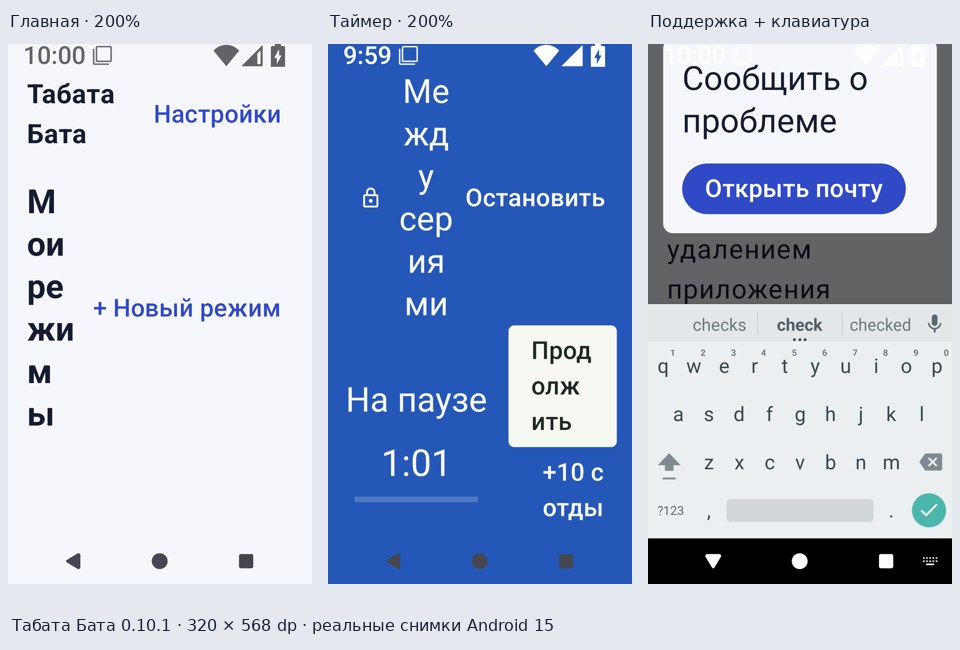
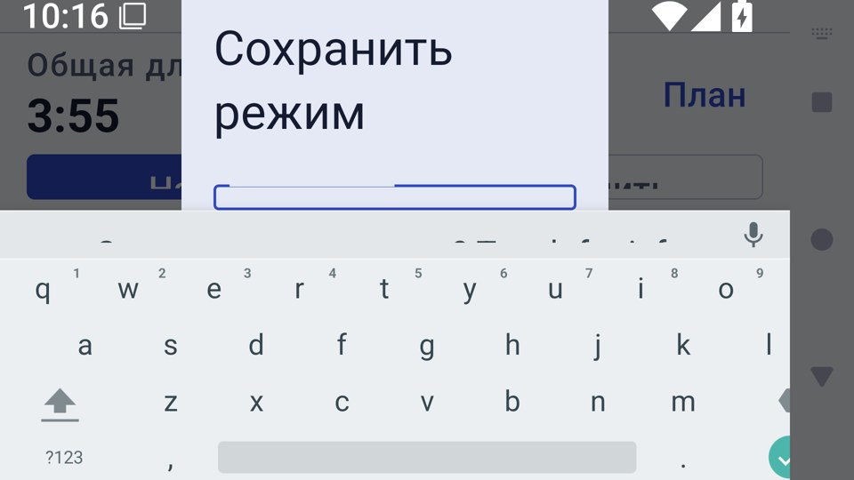

# Независимый аудит UI, UX и отклика — 11 ноября 2026

Проверено приложение 0.10.1 / versionCode 20, исходный код приложения `2ac3ae5696240fcb6485f81998ff4a1ed58f5785`; документация/проверки на main `bebe298748119100e189f044e4ac72e1afafdbc8`. Проверяемый UI не менялся между этими коммитами. Это аудит, а не исправление найденных дефектов и не новая пользовательская APK.

## Вывод

На обычном телефоне основные действия понятны и доступны, время и кнопки выровнены. Однако утверждать, что вся вёрстка устойчива, нельзя. Подтверждены две приоритетные проблемы: часы/управление тренировки при крупном шрифте и диалоги с клавиатурой. Ещё три группы замечаний относятся к заголовкам, кнопкам редактора и результату в коротком окне. Отдельно есть предложения по навигации и feel; они не выдаются за поломки.

Скриншоты получены из установленного приложения на эмуляторе Android, а не из макета. Данные режимов и истории синтетические. В подборке: 320 × 568 dp, русский язык, системный шрифт 200%.

## Как проверялось

Собраны debug APK и instrumentation APK, пройдена навигация настоящего приложения, снимались системные скриншоты и данные Compose. Дополнительно прочитан код компоновки/переходов и просмотрены прежние скриншоты того же кода приложения с реально загруженными тестовыми баннерами. Production-реклама, отправка писем и публикация отзыва не запускались.

| Профиль | Android | Размер окна, ориентировочно | Шрифт | Язык / тема |
|---|---|---|---|---|
| Обычный телефон | 15 / API 35 | 411 × 731 dp, портрет | 100% | RU / светлая |
| Узкий телефон | 15 / API 35 | 320 × 568 dp, портрет | 200% | RU / светлая |
| Узкий телефон | 15 / API 35 | 320 × 568 dp, портрет | 150% | EN / тёмная |
| Короткое окно | 15 / API 35 | 640 × 360 dp, горизонтально | 150% | EN / тёмная |
| Короткое окно | 15 / API 35 | 640 × 360 dp, горизонтально | 200% | RU / светлая |
| Планшет | 15 / API 35 | 800 × 1280 dp, портрет | 100% | RU / тёмная |
| Обычный телефон | 16 / API 36 | 411 × 731 dp, портрет | 100% | EN / светлая |

Размеры указаны до вычитания системных панелей. Это выборка адаптивности, не обещание совместимости с каждой моделью телефона. Смена ориентации в этих прогонах задавалась до сценария; отдельного нового аппаратного теста поворота посреди занятия здесь нет.

Проверены: пустая/заполненная главная, готовые режимы и их отключение; длинные названия до 100 символов; меню ⋮, редактирование, копирование, удаление и перестановка; редактор, длительность 60:00, неверный ввод, оформление, несохранённые изменения; сохранение нового режима и клавиатура; план и раскрытие серии; пустая/заполненная история, недельная сводка, повтор и очистка; настройки сигналов/голоса/вибрации/поведения; поддержка, копирование отчёта и клавиатура; объяснение уведомлений; восстановление прерванной тренировки; все типы этапов, пауза, блокировка, остановка и результат.

## Подтверждённые дефекты

### UX-01 · P1 — часы и управление сжимаются при крупном тексте

**Воспроизведение:** RU, 320 × 568 dp, шрифт 200%, тренировка с подготовкой, работой, отдыхом, несколькими сериями и заминкой.

Название этапа между замком и «Остановить» получает слишком маленькую ширину, переносится почти по буквам и отнимает высоту у часов. Часы не видны на PREPARE / WORK / REST / COOL; на BETWEEN они резко уменьшаются. На BETWEEN кнопка следующего этапа не отображается в доступной области. Проблема также заметна после восстановления на паузе. Это потеря основной функции экрана, а не просто длинная подпись.

При EN 150% на узком телефоне часы остаются видны, но их размер/положение меняются для BETWEEN и COOL. В отдельном EN горизонтальном профиле счётчик раундов/серий зажат между кнопками этапов и распадается на фрагменты слов.

**Причина по коду:** `WorkoutScreen.kt`: одна строка заголовка с `weight(1f)` у названия; решение о двух колонках принимается по оставшемуся пространству после заголовка; счётчик делит строку с двумя кнопками. Высокий заголовок способен дополнительно переключить оставшуюся область в тесную двухколоночную компоновку. Это вывод из кода и снимков, не результат профилирования каждой фазы измерения.

**Исправление:** адаптивно отделить название от управления, выделить часам устойчивую область, выбирать компоновку по окну/доступной высоте осознанно; счётчик вынести на собственную строку. При нехватке места сначала уплотнять вторичную информацию. Сохранить одинаковую область часов между этапами и место под «+10 с».

**Критерий приёмки:** часы, пауза/продолжение, остановка и переход этапа видны и доступны во всех пяти типах этапов на 320 dp / 200% и в коротком горизонтальном окне; название не превращается в вертикальную цепочку букв.

### UX-02 · P1 — диалоги не выдерживают клавиатуру и малую высоту

**Поддержка:** в RU 320 dp / 200%, EN горизонтально / 150% и RU горизонтально / 200% клавиатура оставляет только часть содержимого/действий. Поле описания, «Скопировать» и «Закрыть» могут исчезнуть. На EN 320 dp / 150% поле тоже сжимается, хотя действия могут оставаться доступны.

`SupportDialog.kt` ограничивает высоту поверхности, отдельно размещает заголовок и FlowRow действий, а прокручивает только середину. При малой доступной высоте середина почти исчезает, затем перестают помещаться действия. Возможное дополнительное влияние обработки IME требует проверки при исправлении: двойной учёт клавиатуры здесь не доказан.

**Название нового режима:** визуальная проверка RU горизонтально / 200% показала, что клавиатура закрывает поле и кнопки. При этом `assertIsDisplayed()` для кнопок проходит: наличие/геометрия Compose-узла не гарантирует, что системная IME его не перекрыла. Поэтому положительный тест не считается подтверждением исправной вёрстки.

В диалоге восстановления в этом же коротком окне поясняющий текст исчезает, хотя оба действия остаются доступны. Это менее критичный симптом той же нехватки высоты. Диалоги уведомлений и обычный портретный диалог названия визуально читаемы.

**Исправление:** единая проверка всех диалогов при IME/200%; в коротком окне — прокручиваемое содержимое целиком или подходящий полноэкранный редактор. Не оставлять фиксированные заголовок и действия, которые вместе выше окна. Явный выход должен оставаться доступен. После ввода названия сохранение не должно требовать догадаться, что сначала нужно закрыть клавиатуру системной кнопкой.

### UX-03 · P2 — заголовки вытесняются соседними действиями

RU 320 dp / 200%: «Мои режимы» разбивается почти по буквам рядом с «+ Новый режим». Заголовок занимает экран, список ниже первого видимого окна. В настройках/истории похожая проблема возникает у глобального заголовка рядом с возвратом к режимам.

**Код:** строка заголовка `HomeScreen.kt`, общий верхний ряд `MainActivity.kt`.

**Исправление:** переход к двум строкам/вертикальному расположению заголовка и действия при нехватке ширины; поддержать системный масштаб текста. Не решать проблему отключением масштабирования или обрезанием основного заголовка. На обычной ширине сохранить компактный вариант.

### UX-04 · P2 — подписи основных кнопок редактора ломаются внутри слов

RU 320 dp / 200%: равные половины нижнего ряда дают «Начат / ь» и «Сохра / нить». Нижняя сводка дополнительно уменьшает видимую область формы. В подтверждении несохранённых изменений тоже есть некрасивые переносы действий на этом размере. Кнопки в этих состояниях доступны; проблема в читаемости и иерархии.

**Код:** закреплённая нижняя область `EditorScreen.kt`, диалог несохранённых изменений `MainActivity.kt`.

**Исправление:** при крупном тексте располагать действия по вертикали/разрешать им полноценную ширину; компактно компоновать сводку. Проверять весь нижний блок с IME и без неё. Значение времени 60:00 уже помещается корректно — этот механизм не ломать.

### UX-05 · P2 — действия результата оказываются ниже первого экрана

В горизонтальном окне результат сначала показывает заголовок и сводку, а «Повторить» / «К режимам» остаются ниже. Прокрутка позволяет добраться до них, то есть экран не заблокирован, но завершение обычного сценария требует лишнего поиска. Наличие места под баннер дополнительно уменьшает высоту, но само рекламное место на проверенных снимках отделено от системной навигации и контента.

**Код:** ветка результата `WorkoutScreen.kt`: верхний отступ, вертикальная колонка и интервалы между элементами.

**Исправление:** компактная компоновка результата по доступной высоте, в горизонтальном окне возможны две колонки. Основные действия должны быть видны сразу на обычном масштабе; при 200% весь результат должен предсказуемо прокручиваться.

## Удобство и feel — предложения, не функциональные дефекты

1. **Одинаковое нажатие на карточку должно означать одно действие.** Сейчас тело своей карточки открывает редактор, а готовой — план. Рекомендация: тело любой карточки открывает план, редактирование находится в ⋮, «Начать» остаётся отдельным действием. Решение стоит подтвердить как продуктовый выбор перед изменением привычной навигации.
2. **Планшетная сетка.** Форма/настройки тянутся почти на всю ширину, подписи и действия далеко друг от друга. Ограничить ширину основного неигрового содержимого примерно 600–720 dp и центрировать; тренировка может использовать больше пространства. Это улучшение читаемости, не выявленная потеря доступа.
3. **Ориентация в настройках.** Заголовок «Настройки» поможет быстрее понять, где находишься; сейчас сверху остаётся имя приложения. Разделы и сами параметры понятны.
4. **Завершение занятия.** После насыщенных цветов этапов результат воспринимается довольно плоско. Можно добавить короткое появление отметки завершения/чисел, без задержки кнопок и без дополнительной обязательной анимации. Сначала исправить сетку и доступность действий.
5. **Тактильный размер строк выбора.** У тем/голоса используются родительские кликабельные строки с неактивным дочерним RadioButton. Compose расширяет маленькую область нажатия автоматически, поэтому по размеру видимого кружка нельзя объявить кнопку недоступной. При доработке стоит явно резервировать минимум 48 dp для строки и исключить наложение соседних расширенных областей; отдельного аппаратного замера промахов здесь нет.

Уже удачно: ускорение удержания ± с паузой перед повтором; небольшое уменьшение нажатой кнопки; устойчивые цвета этапов; короткие переходы без задержки запуска таймера; отдельная крупная пауза; блокировка от случайных действий; подтверждение остановки. Новые эффекты здесь нужны дозированно. Самый заметный выигрыш в feel даст предсказуемое положение часов и управления.

По коду `SportControls.kt` кнопка сжимается до 0.92, повтор начинается через 400 мс, интервалы затем 180 / 90 / 40 мс. Цвет этапа меняется за 160 мс; нерабочие экраны используют fade 140 мс, запуск тренировки не ждёт fade. Эти значения описывают реализацию, а не измеренную задержку телефона. Систематического измерения FPS/jank на физическом устройстве не было.

## Что выдержало проверку

- Обычный портретный интерфейс не демонстрирует массовых обрезаний. Основные внешние отступы согласованы; редактор уже перестраивает строки на узкой ширине.
- На обычном телефоне часы во всех девяти позициях тестового плана имеют одинаковую рамку `(153, 536)–(927, 1007)` px. Это подтверждает стабильность нормального варианта, но не отменяет UX-01. В EN 320 dp / 150% рамки PREPARE/WORK/REST — `(341, 492)–(619, 661)`, BETWEEN — `(374, 543)–(587, 674)`, COOL — `(290, 512)–(671, 744)`; положение и размер различаются.
- Длинные названия карточек ограничиваются предусмотренным многоточием. Это намеренное сокращение, не выход текста за границы. Полный план доступен в прокручиваемом preview.
- Ошибочный ввод времени блокирует запуск/сохранение; большое корректное значение помещается.
- Меню ⋮, история и длинные планы доступны через соответствующую прокрутку. Повтор сохранённого плана и очистка истории работают в проверенных сценариях.
- Подпись предпросмотра финиша в настройках помещается; прежний дефект с длинной надписью не воспроизведён.
- Проверка копирования отчёта на Android 16 проходит, если дождаться подтверждения копирования. Старое немедленное чтение буфера не является доказательством пользовательского дефекта.
- По 11 выбранным основным парам цветов минимальный расчётный контраст 5.50:1; основной текст около 16:1. Это проверка цветов, не полная сертификация доступности.
- На просмотренных реальных снимках с тестовым баннером рекламная область и системная навигация не перекрывают кнопки. Это выборочная проверка компоновки; доходность и production-инвентарь в этот аудит не входят.

## Доказательства и ограничения автоматизации

Исходники специального прогона находятся в ветке [ui-ux-audit-20261111](https://github.com/DanilaH/tabata-bata/tree/ui-ux-audit-20261111): `scripts/ux/UxAuditProbe.kt`, `scripts/ux/run.sh` и `.github/workflows/ui-ux-audit.yml`. Они не изменяют пользовательский UI.

- [Основная матрица, снимки всех экранов и raw JUnit](https://github.com/DanilaH/tabata-bata/actions/runs/43001212563). EN 150% узкий, планшет и Android 16: raw JUnit `OK (9 tests)`. RU 200% узкий: реальные сбои видимости часов/кнопки этапа и поддержки. Короткие горизонтальные окна: реальный сбой поддержки. У трёх профилей также был неверный поиск лениво создаваемых элементов истории в самом тесте. Обычный RU job завис на первой реализации фоновой записи; результат этого job не используется как доказательство исправности/поломки приложения.
- [Исправленная отдельная проверка истории](https://github.com/DanilaH/tabata-bata/actions/runs/43002458580): все три проблемных профиля PASS. Проверка сначала прокручивает LazyColumn к элементу, затем оценивает его наличие. Ошибка теста не записана в дефекты продукта.
- [Повтор истории и отдельный feel-сценарий](https://github.com/DanilaH/tabata-bata/actions/runs/43002923842): все четыре jobs PASS. В первой feel-записи ожидание через `SystemClock.sleep` останавливало продвижение Compose test frame clock между действиями: такой ролик не подходит для оценки плавности/хода секунд. Это ограничение стенда, а не найденный дефект TimerService. Для наблюдения кадров ожидание заменено на frame-aware wait. [Отдельный повтор](https://github.com/DanilaH/tabata-bata/actions/runs/43003951367) PASS: в записи 33 секунды видны удержание плюса, редактирование, реальный отсчёт 4-секундных этапов, подготовка → работа → отдых, пауза, блокировка/разблокировка и отмена остановки. Визуально кадры просмотрены; звук выключен. Ролик не используется как замер FPS/задержки реального телефона.
- В предшествующих попытках исправлены проблемы стенда: недоступный внешний каталог артефактов, ожидание диалога после возврата формы ровно к исходному состоянию и отсутствие `rg` на runner. Поэтому красный статус старой job целиком нельзя выдавать за пользовательский баг. Итоговый парсер использует Python; вывод JUnit и снимки сохранены отдельно.
- `hasVisualOverflow` / `didOverflowWidth` выдавали флаги даже у визуально помещающихся строк: сохранённая ширина paragraph отличалась от фактического контейнера. Массовый подсчёт этих флагов не используется. Выводы основаны на видимых снимках, доступности действий и коде компоновки. Случай названия под IME отдельно показывает ограничение чистой semantics-проверки.

Вибрация, фактическая громкость/тембр динамика, Bluetooth, читаемость на солнце и удобство мокрыми руками этим стендом не подтверждены. В fixture звук и вибрация специально выключены; впечатление от аппаратного сигнала нельзя получить из скриншота или бесшумного видео. Не проводился пользовательский тест с людьми, впервые увидевшими приложение: понятность навигации оценена по маршрутам, подписям и последовательности действий.

## Порядок доработки и повторная приёмка

1. UX-01: заголовок/часы/управление тренировки. Проверить все типы этапов, паузу, восстановление, блокировку и смену ориентации во время занятия.
2. UX-02: диалоги с клавиатурой, малой высотой и 200% текста. Проверять реальный кадр поверх IME, а не только Compose semantics; сохранить доступные поле/сохранение/выход.
3. UX-03 / UX-04 / UX-05: адаптивные заголовки, нижние действия редактора и результат. Повторить обе темы и RU/EN; проверить крайние названия/значения и рекламное место на разрешённых экранах.
4. Затем согласованность карточек, ограничение ширины на планшете и небольшая полировка результата. Не менять точный ход таймера ради анимации.
5. Прогнать основную матрицу повторно на исправленном коде, затем обычные unit/UI/lint/release проверки. Короткая физическая проверка сигналов и восприятия переходов останется отдельной.

Первичные рекомендации для проверки: [Android — доступность и размер нажатий](https://developer.android.com/guide/topics/ui/accessibility/apps), [Compose — автоматическое расширение области нажатия](https://developer.android.com/develop/ui/compose/accessibility/api-defaults), [WCAG — контраст текста](https://www.w3.org/WAI/WCAG22/Understanding/contrast-minimum.html).
